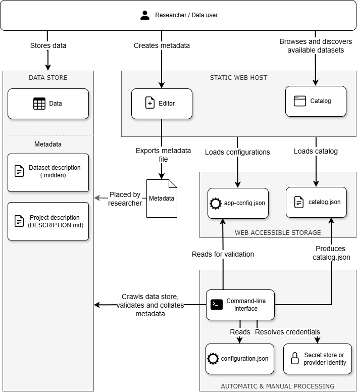

# Summary

Reproducible research depends on preserving raw data provenance and descriptive metadata across the research lifecycle, yet small and medium research teams often face a persistent documentation gap. Existing solutions typically demand centralized database infrastructure with complex backend administration or early migration to third-party cloud platforms---creating sociotechnical friction, raising data sovereignty concerns for unpublished data, and causing metadata creation to be deferred until publication. Midden addresses these operational constraints through a lightweight, decentralized software architecture that decouples metadata discovery from centralized database hosting while integrating seamlessly into standard research workflows. Metadata are stored as human-readable plain-text files located directly alongside the data. A cross-platform command-line utility aggregates these distributed records into a centralized catalog without altering existing data access permissions or storage structures, while a web application renders the catalog to enable discovery through interactive maps, data lineage graphs, and data dictionaries. Midden is available at <https://github.com/cafincubator/midden>.

# Statement of need

Best practices for research data management converge on a few recurring themes: assigning an embedded data manager [@Kaplan:2021]; preserving raw data separately from processed data to retain provenance [@Borghi:2022]; keeping data access restricted while still enabling metadata to be shared and discovered [@Gomes:2022]; storing metadata alongside data rather than in a disconnected system [@Willoughby:2022]; and lowering the barrier to creating metadata so that documentation happens early rather than being deferred until publication [@Michener:1997; @Wilkinson:2016]. Despite several scientific funders requiring a dedicated manager be named within research proposals, few collaborative teams have adequately filled this need, so collective data management is often required [@Baker:2018].

Midden was designed specifically for this earlier stage of the data lifecycle, while data are actively being collected and processed. It does not host, copy, or provide access to underlying data; it only records *where* datasets are stored and *what* they contain, leaving access control and storage to the systems already used by the research team. Metadata is stored as human-readable files that are co-located with the data so it remains accessible and useful to researchers working directly with their data systems. A few essential fields are required for the metadata to be validated by Midden, letting the completeness of documentation grow as researchers' time allows. This design fosters early contribution of metadata and breaks down sociotechnical barriers. Any researcher with write access to the data storage system can take on the responsibility for creating and managing metadata, essentially capturing critical contextual information for researchers to work most efficiently with data in the future. The Midden architecture was built to democratize metadata generation, distributing documentation across the researchers who know the data best rather than leaving it to a single data manager.

# State of the field

Existing solutions tend to treat data as an additional outcome of scientific research. General-purpose repositories (e.g., Dataverse, Figshare, OSF) and enterprise catalogs (e.g., OpenMetadata, DataHub, Amundsen) are built around centralized storage or complex infrastructure [@Reichman:2011], and are typically utilized at the point of publication rather than during active data collection and processing. Consequently, researchers have few lightweight options that are straightforward and that reflect existing file organization and data governance while still enabling data discovery by the research team.

# Software design

Midden's architecture centers on a single core .NET class library (`Caf.Midden.Core`) that handles all versioned metadata domain models, schema knowledge, file-format parsing, and validation rules. This design decouples core logic from the user interface. Two thin front-ends rely on this library: a Blazor WebAssembly single-page application (`Caf.Midden.Wasm`) and a cross-platform command-line utility (`Caf.Midden.Cli`). The architecture of Midden utilizes a publishing workflow model rather than a persistent backend database. The command-line utility crawls storage systems to validate `.midden` and `DESCRIPTION.md` files, aggregating them into a single `catalog.json` file that is consumed by the web application. Storing metadata as co-located, human-readable files ensures it remains accessible and useful to researchers within their normal workflow.

## Web application

Beyond metadata creation tools, the web application enables exploration of organizational data holdings (\autoref{fig:dashboard}). The Home dashboard displays catalog-wide metrics (e.g. counts of projects, datasets, variables, and contributors) alongside recent additions and dataset growth trends. Faceted browsing and keyword search across datasets, variables, projects, and user-defined tags support multi-avenue discovery. Each dataset page displays geospatial coverage using an interactive map driven by [GeoJSON](https://geojson.org/) geometry. Additionally, a zoomable data lineage graph visualizes relationships between parent and derived datasets, enabling provenance tracing without manually assembling descriptive documentation (\autoref{fig:dataset}). Together, these features streamline the research workflow from initial data identification to comprehensive evaluation of location, content, and provenance.

## Data flow

The data workflow begins when a researcher conceptualizes a dataset (\autoref{fig:flow}). Using the web-based metadata editor, the researcher fills out a corresponding metadata file, downloads the GeoJSON file, and stores it at the current or future location of the dataset. An automated script or manual process then invokes the command-line utility, which scans the configured data storage systems, discovers metadata files, and validates them against the schema rules defined in the core library (e.g. values for required fields, properly formatted GeoJSON, proper utilization of controlled terms).

Upon validation, the aggregated dataset catalog (`catalog.json`) is generated. Because Midden follows a publishing workflow model rather than relying on a persistent backend database, updating the public catalog simply requires aggregating and deploying the `catalog.json` file. End users and collaborators can subsequently browse and query the catalog via the web application.

# Research impact statement

Research funders invest billions of dollars in the collection and interpretation of scientific data that supports new novel insights and innovations for our society. However, data and the contextual information necessary to understand it are not regularly treated as assets to be found again and leveraged to produce new findings or understand long-term trends. Midden has been developed by, and used internally within, the USDA-ARS Cook Agronomy Farm to track and manage research data as valuable digital assets. The Cook Agronomy Farms participates in several research networks including the Long-Term Agroecosystem Research (LTAR) Network [@Tsegaye:2024], the Washington Soil Health Institute, and the AI Institute for Transforming Workforce and Decisions Support. These scientific communities consist of thousands of researchers who collectively produce terabytes of data every year and all share the need to find, re-use and co-author with those data. They also have shared lessons learned regarding management of their digital scientific evidence that support various peer-reviewed results. Thus Midden includes several features that satisfy the need to track datasets across multiple ongoing experimental field and modeling projects [@Carlson:2023]. Feedback from early adopters from the LTAR network and universities has shaped the current feature set, including project- and dataset-level metadata editors, a metadata catalog with faceted browsing by project, variable, and tag, a data lineage viewer, and support for common cloud and network storage data systems. Early adopters are also well-positioned to provide training within their scientific communities, where Midden will have a broad impact on ensuring that research data will be findable and reusable well into the future to support local research sites as well as large collaborative research networks and beyond.

# AI usage disclosure

Generative AI tools (Anthropic Claude) were used to assist in drafting and revising this manuscript from a detailed outline. Development of Midden occurred in two distinct phases regarding AI assistance: versions 0.1--0.4 were developed entirely without the use of AI tools; subsequent versions utilized AI to assist in modernizing .NET dependencies and in completing specific interface features, particularly regarding the catalog. All AI-assisted code, text, and structural contributions were reviewed, verified against the codebase, and edited, if needed, by the human authors, who maintain full responsibility for the manuscript's accuracy and the software's integrity.

# Acknowledgements

We thank the LTAR Data Management Deliverable Team members and collaborators at partner institutions who provided feedback throughout Midden's development. This research was a contribution from the Long-Term Agroecosystem Research (LTAR) Network. LTAR is supported by the United States Department of Agriculture. The contents of this publication do not necessarily reflect the views or policies of the US Department of Agriculture, nor does mention of trade names, commercial products or organizations imply endorsement by the US Government. USDA is an equal opportunity provider, employer, and lender.

# References
